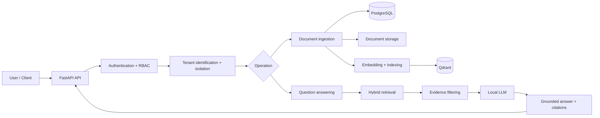
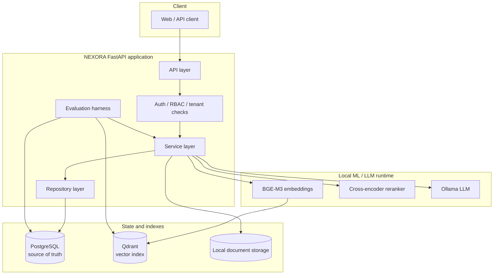
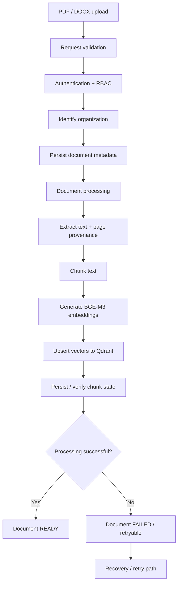
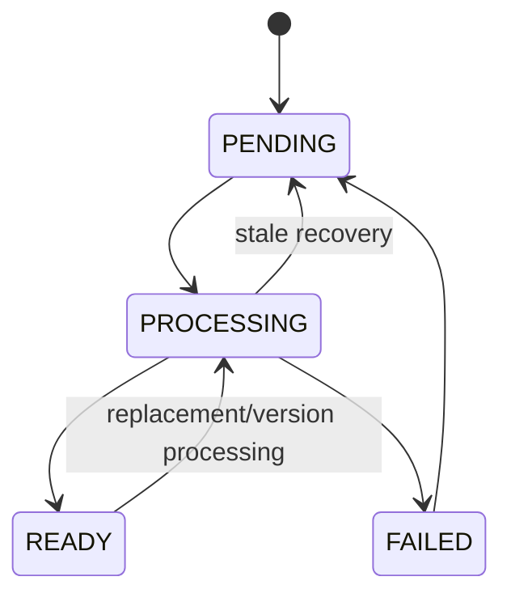
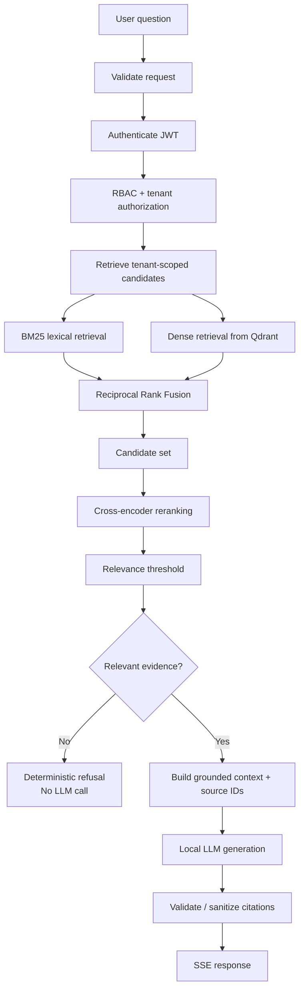
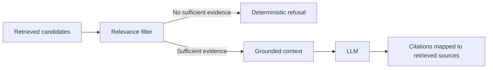
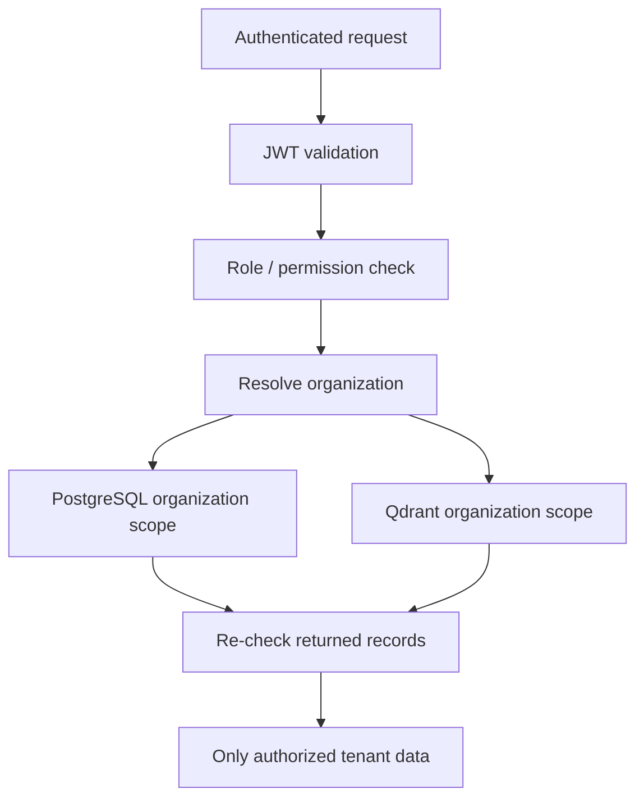
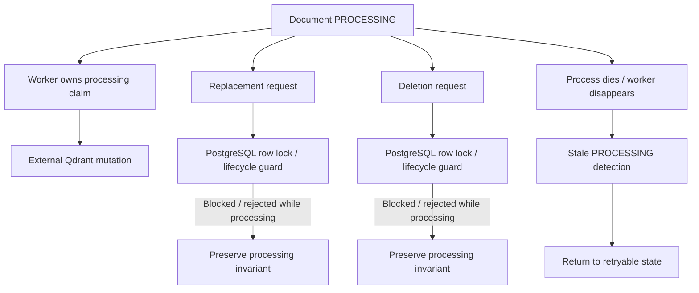

# NEXORA

**Production-oriented multi-tenant Enterprise RAG platform** built as a FastAPI modular monolith.

NEXORA lets organizations upload PDF/DOCX documents and ask questions against their own data. The system retrieves evidence first, generates grounded answers with source citations, and refuses when the available evidence is insufficient.

> **Evaluation note:** the current live retrieval benchmark uses 16 documents, 220 chunks, and 60 evaluation questions. The results below are benchmark measurements, not production SLAs or universal accuracy claims.

---

## 1. What NEXORA actually does

NEXORA is not a generic `query → vector DB → LLM` chatbot. The application separates **identity, tenant isolation, document lifecycle, retrieval, evidence selection, generation, and evaluation** into explicit stages.

At a high level:



The core RAG orchestration is implemented directly in Python rather than relying on LangChain/LangGraph as the application orchestration layer.

---

## 2. Architecture at a glance

### System boundaries



### Responsibility of each layer

| Layer | Responsibility |
|---|---|
| API | Request validation, HTTP/SSE responses, authentication entry points |
| Security | JWT validation, RBAC, tenant identification, authorization |
| Services | Document processing, retrieval orchestration, answer generation, lifecycle rules |
| Repositories | Database access and organization/document/chunk scoping |
| PostgreSQL | Source of truth for users, organizations, documents, versions, chunks, audit state |
| Qdrant | Vector retrieval index; not the authoritative document store |
| Local storage | Uploaded source files |
| Models | Embeddings, reranking, and local LLM generation |
| Evaluation | Reproducible retrieval/answer evaluation and benchmark cleanup |

---

## 3. Document ingestion flow

The ingestion path is deliberately separated from the query path.



### Ingestion responsibilities

1. Validate file type, size, and content signature.
2. Authenticate the request and enforce organization permissions.
3. Create the document/version state in PostgreSQL.
4. Extract PDF/DOCX text while preserving page provenance where supported.
5. Split extracted text into retrieval chunks.
6. Generate BGE-M3 embeddings.
7. Index vectors in Qdrant with organization/document metadata.
8. Mark the document `READY` only after successful processing.
9. Recover stale `PROCESSING` documents and explicitly handle failed-document retry semantics.

### Document lifecycle



The lifecycle is important because document processing crosses PostgreSQL and Qdrant boundaries. NEXORA uses database locking and lifecycle guards to prevent conflicting replacement/deletion operations while processing is active.

---

## 4. Query / RAG flow

This is the core request path from a user question to a grounded response.



### Why the retrieval pipeline is staged

**BM25** handles exact lexical signals such as policy names, identifiers, terminology, and wording.

**Dense retrieval** handles semantic similarity where the query and source use different wording.

**RRF** combines rankings without requiring BM25 and vector similarity scores to be directly comparable.

**Cross-encoder reranking** evaluates a smaller candidate set with a more expensive query/document relevance model.

**Relevance filtering** prevents weak candidates from becoming context for the LLM.

**Grounded generation** receives only the selected evidence and source identifiers.

**Citation validation** ensures generated citation markers correspond to actual retrieved sources.

The system does **not** assume that every stage must improve the benchmark. Each stage is measurable and its effect is documented.

---

## 5. Grounding and refusal behavior

NEXORA has an explicit evidence boundary between retrieval and generation.



Two mechanisms are used:

1. **Deterministic refusal:** if no chunk survives the relevance threshold, the system returns a refusal without making an LLM call.
2. **Grounded generation:** when evidence exists, the LLM is instructed to answer from the retrieved context and decline when that context is insufficient.

Retrieved chunks are numbered and returned as structured sources. Invalid citation markers are removed after generation so citations map to actual retrieved sources.

---

## 6. Multi-tenancy and security model

Tenant isolation is treated as a **correctness and security requirement**, not merely a frontend convention.



Security controls include:

- organization-scoped API and service operations
- organization filtering in PostgreSQL and Qdrant
- PostgreSQL re-check of returned vector hits before their text is exposed
- owner/admin/member authorization model
- Argon2 password hashing
- JWT expiry enforcement
- rotating and revocable refresh tokens
- JTI denylisting
- login throttling
- upload size, content-type, and magic-byte validation
- guarded local file storage
- parameterized/ORM database access
- static error responses that avoid internal leakage
- request IDs without logging request bodies or secrets
- append-only audit logging with an allowlisted detail set
- production configuration validation

---

## 7. Reliability and concurrency

A major part of NEXORA is protecting document state when multiple operations interact with the same document.



Implemented safeguards include:

- PostgreSQL row locking around processing claims
- protection against replacement/deletion while processing
- stale `PROCESSING` recovery
- explicit `FAILED → PENDING` retry semantics
- processing lease refresh before external indexing
- locking before Qdrant mutation for replacement/deletion
- regression tests for lifecycle races

Qdrant is treated as an index rather than the source of truth. Normal retrieval only exposes chunks belonging to `READY` documents.

---

## 8. Evaluation architecture

The evaluation harness is designed to test the actual retrieval path rather than only scoring an isolated function.

```mermaid
flowchart TD
    D[Evaluation dataset] --> SEED[Create isolated benchmark organization]
    SEED --> INGEST[Run production ingestion / indexing path]
    INGEST --> CORPUS[16 documents / 220 chunks]
    CORPUS --> QUESTIONS[60 labeled questions]

    QUESTIONS --> B1[BM25]
    QUESTIONS --> B2[Dense]
    QUESTIONS --> B3[Hybrid RRF]
    QUESTIONS --> B4[Hybrid + reranker]
    QUESTIONS --> B5[Hybrid Full]

    B1 --> METRICS[Recall@1/5/10 + Precision@10 + MRR]
    B2 --> METRICS
    B3 --> METRICS
    B4 --> METRICS
    B5 --> METRICS

    METRICS --> REPORT[Recorded benchmark results]
    REPORT --> CLEAN[Cleanup benchmark state]
    CLEAN --> VERIFY[Verify PostgreSQL + Qdrant are clean]
```

The benchmark creates temporary data, runs through the real production ingestion/indexing path, measures retrieval configurations, and removes the temporary organization and associated data afterward.

---

## 9. Current live retrieval evaluation

The current live benchmark uses:

- **16 documents**
- **220 chunks**
- **60 evaluation questions**

| Configuration | Recall@1 | Recall@5 | Recall@10 | Precision@10 | MRR |
|---|---:|---:|---:|---:|---:|
| BM25 | **66.67%** | 86.67% | 95.00% | 9.50% | **0.7483** |
| Dense | 63.33% | 86.67% | **100.00%** | 10.00% | 0.7334 |
| Hybrid RRF | 63.33% | **93.33%** | **100.00%** | 10.00% | 0.7481 |
| Hybrid + reranker | 63.33% | **93.33%** | **100.00%** | 10.00% | 0.7440 |
| Hybrid Full | 63.33% | 83.33% | 85.00% | 8.50% | 0.7056 |

### Interpretation

- **66.67% is the best Recall@1**, not 93.33%.
- **93.33% is Recall@5** for Hybrid RRF and Hybrid + reranker.
- **100% Recall@10** means the labeled relevant evidence was present within the top ten retrieved results for those configurations.
- The cross-encoder **did not improve the current benchmark**: its MRR is 0.7440 versus 0.7481 for RRF.
- These values are benchmark measurements, **not answer accuracy, production SLAs, or universal performance claims**.

### Cleanup verification

The completed live benchmark left:

- **0 documents**
- **0 chunks**
- **0 organizations**
- **0 users**
- **0 Qdrant points**

This verifies that the temporary benchmark state was removed from both PostgreSQL and Qdrant.

Detailed evaluation methodology and historical results are documented in [`docs/evaluation.md`](docs/evaluation.md).

---

## 10. Technology stack

| Concern | Technology |
|---|---|
| API | FastAPI, Starlette, Uvicorn |
| Validation/config | Pydantic v2, pydantic-settings |
| Database | PostgreSQL 17, SQLAlchemy 2.0, Alembic |
| Vector store | Qdrant |
| Embeddings | `BAAI/bge-m3`, sentence-transformers |
| Lexical retrieval | `rank-bm25` / BM25Okapi |
| Reranker | `cross-encoder/ms-marco-MiniLM-L-6-v2` |
| Chunking | `langchain-text-splitters` |
| LLM | Ollama (`qwen3:8b` default) |
| Authentication | PyJWT, Argon2 via pwdlib |
| Documents | PyMuPDF, python-docx |
| Testing | pytest |
| Deployment | Docker / Docker Compose |
| CI | GitHub Actions |

There is no LangChain core, LangGraph, Redis, or Celery dependency in the core application flow.

---

## 11. Supported documents and explicit boundaries

### Supported

- PDF
- DOCX, including DOCX tables

### Not currently claimed

- OCR for scanned/image-only PDFs
- image understanding
- PDF table extraction
- arbitrary formats such as XLSX/PPTX/CSV/HTML

Chunking preserves page provenance for PDFs.

---

## 12. Evaluation commands

### Offline BM25 benchmark

```bash
.venv/bin/python -m backend.evaluation.benchmark
```

### Current live retrieval benchmark

```bash
HF_HUB_OFFLINE=1 .venv/bin/python -u -m backend.evaluation.benchmark --live
```

### End-to-end answer benchmark

```bash
.venv/bin/python -m backend.evaluation.answer_benchmark
```

The live retrieval benchmark requires local PostgreSQL, Qdrant, embedding, and reranker runtime. It creates temporary benchmark data and removes it after the run.

---

## 13. Local development

```bash
python -m venv .venv
source .venv/bin/activate
python -m pip install -r requirements-dev.txt
docker compose up -d
ollama pull qwen3:8b
cp .env.example .env
alembic upgrade head
python -m uvicorn backend.main:app --reload
```

API: `http://127.0.0.1:8000`

Swagger/OpenAPI: `http://127.0.0.1:8000/docs`

Health: `http://127.0.0.1:8000/health`

---

## 14. Production scope

The repository contains a non-root multi-stage Docker image and production Compose configuration with PostgreSQL and Qdrant.

A real larger deployment would additionally require operational decisions around persistent/shared object storage, distributed rate limiting, durable ingestion, TLS, backups, observability, load testing, and capacity planning.

These are intentionally not represented as implemented features unless they are actually present in the repository.

---

## 15. Honest limitations

NEXORA is a **production-oriented engineering project**, not a claim of a fully managed production SaaS system.

Known limitations include:

- controlled and relatively small evaluation corpus
- local disk storage implementation
- process-local login throttling
- FastAPI BackgroundTasks rather than a durable distributed queue
- no OCR/image-only document understanding
- no throughput/concurrency benchmark
- no universal answer-quality or human-helpfulness score
- local LLM latency depends heavily on hardware

The project deliberately favors explicit, testable engineering over adding infrastructure that is not justified by the current requirements.

---

## 16. Repository guide

| Document | Purpose |
|---|---|
| [`docs/evaluation.md`](docs/evaluation.md) | Evaluation methodology, current results, cleanup verification, and historical benchmark separation |
| [`docs/retrieval.md`](docs/retrieval.md) | Retrieval design and benchmark interpretation |
| [`docs/interview-notes.md`](docs/interview-notes.md) | Technical decisions and interview preparation |
| [`RETRIEVAL_BENCHMARK.md`](RETRIEVAL_BENCHMARK.md) | Retrieval benchmark record |
| [`docs/security.md`](docs/security.md) | Security model and controls |
| [`docs/deployment.md`](docs/deployment.md) | Deployment configuration and operational scope |
| [`docs/configuration.md`](docs/configuration.md) | Configuration and environment variables |

---

## 17. Project status

**NEXORA — final engineering/evaluation baseline complete.**

The core application, security hardening, lifecycle recovery, automated testing, CI, evaluation harnesses, live benchmark, cleanup verification, and documentation are in place.

The retrieval benchmark is frozen as a **measured engineering baseline**, rather than being tuned solely for a better headline number.

The next work on NEXORA should be limited to genuine bugs, security issues, reproducibility problems, or evidence-backed improvements—not feature accumulation for resume padding.
