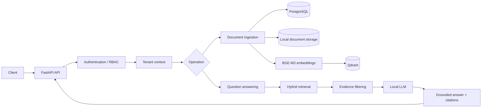
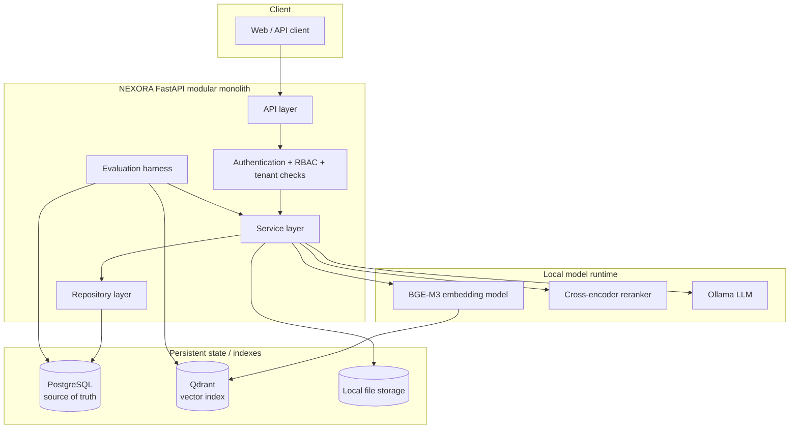
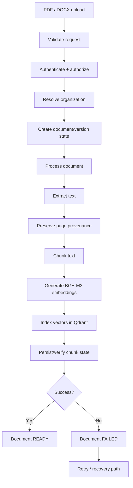
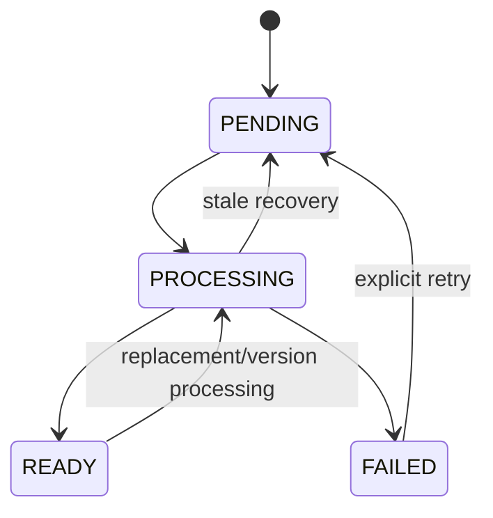
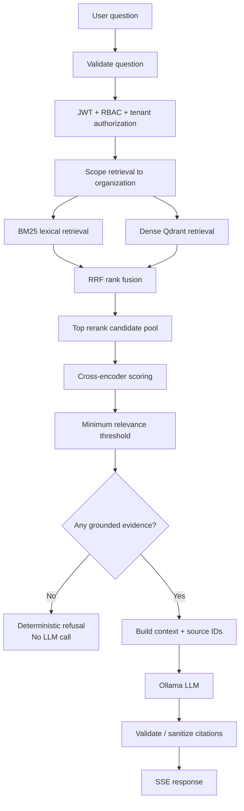
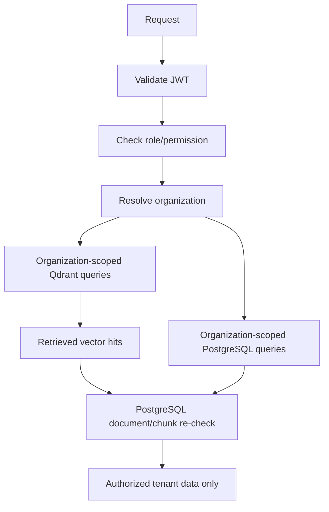
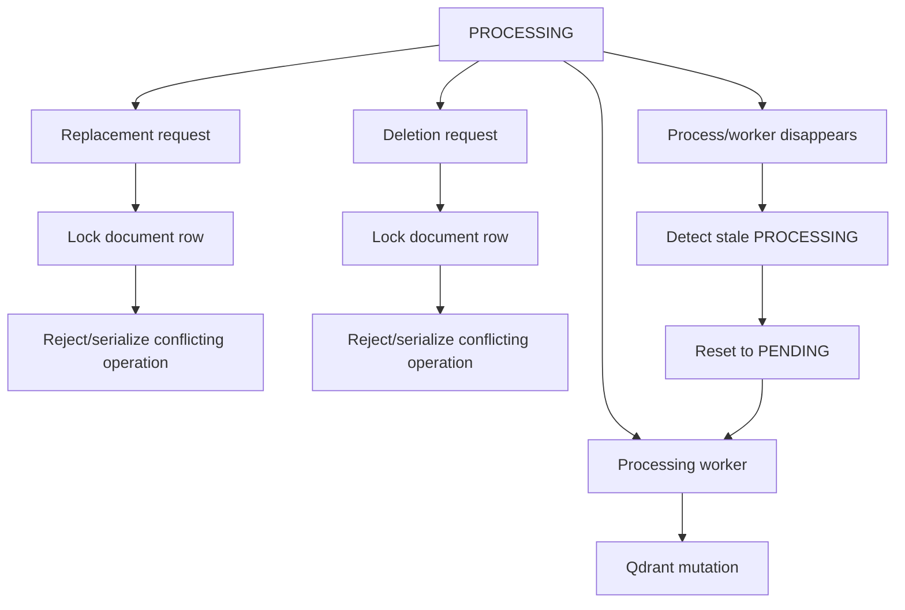

# NEXORA

**Production-oriented multi-tenant Enterprise RAG platform** built as a FastAPI modular monolith.

NEXORA lets organizations upload PDF/DOCX documents and ask questions against their own data. The system retrieves evidence first, filters weak evidence, generates grounded answers with source citations, streams responses over SSE, and refuses when sufficient evidence is unavailable.

> **Honest scope:** NEXORA is a production-oriented engineering project, not a claim of a fully managed production SaaS system. The live retrieval benchmark uses 16 documents, 220 chunks, and 60 labeled questions. Benchmark results are measurements on this corpus, not production SLAs or universal accuracy claims.

---

## 1. System overview

NEXORA is deliberately more than `query → vector database → LLM`. The application separates authentication, tenant isolation, document lifecycle, retrieval, evidence selection, generation, and evaluation.



### Core design principles

- **PostgreSQL is the source of truth** for application and document state.
- **Qdrant is a retrieval index**, not the authoritative document store.
- **Tenant scope is enforced in the backend**, not trusted from the client.
- **Retrieval happens before generation.**
- **Insufficient evidence stops generation.**
- **Document lifecycle state is explicit and recoverable.**
- **Evaluation is reproducible and cleans up its temporary state.**
- The core RAG orchestration is implemented directly in Python rather than using LangChain/LangGraph as the application orchestration layer.

---

## 2. Architecture

### 2.1 Application layers



### 2.2 What each layer owns

| Layer | Responsibility |
|---|---|
| API | HTTP endpoints, request/response validation, SSE streaming entry points |
| Authentication / RBAC | JWT validation, roles, refresh-token lifecycle, authorization |
| Tenant boundary | Organization identification and organization-scoped operations |
| Services | Business logic, document processing, retrieval orchestration, generation, lifecycle rules |
| Repositories | Database access and organization/document/chunk scoping |
| PostgreSQL | Users, organizations, documents, versions, chunks, lifecycle state, audit records |
| Qdrant | Dense-vector index and retrieval candidates |
| Local storage | Uploaded source documents |
| Embedding model | Converts chunks and queries into vectors |
| Reranker | Scores query/chunk pairs and applies relevance thresholding |
| Local LLM | Generates answers only after evidence passes retrieval checks |
| Evaluation | Runs controlled benchmarks and verifies cleanup |

### 2.3 Repository structure

The backend is organized around API, services, repositories, schemas, database access, dependencies, and evaluation rather than putting all logic into route handlers.

```text
backend/
├── api/                 # HTTP/API endpoints
├── core/                # configuration, security, shared infrastructure
├── db/                  # database/session/migration integration
├── dependencies/        # FastAPI dependency wiring
├── repositories/        # persistence and scoped data access
├── schemas/             # request/response models
├── services/            # business logic and RAG pipeline
│   ├── document_extraction.py
│   ├── document_chunking.py
│   ├── embedding_service.py
│   ├── bm25_service.py
│   ├── hybrid_retrieval_service.py
│   ├── document_processing_service.py
│   ├── document_processing_recovery.py
│   ├── generation_service.py
│   └── ...
├── evaluation/          # benchmark datasets and evaluation runners
└── main.py              # application startup and recovery hooks
```

---

## 3. Document ingestion

The ingestion path turns an uploaded source file into a versioned, searchable document.



### Step-by-step

1. **Validate** file type, size, and content signature.
2. **Authenticate and authorize** the caller.
3. **Resolve the organization** that owns the document.
4. **Create document/version metadata** in PostgreSQL.
5. **Extract text** from PDF/DOCX.
6. **Preserve page provenance** for PDF chunks where available.
7. **Chunk the extracted text** for retrieval.
8. **Generate BGE-M3 embeddings** for chunks.
9. **Write vectors to Qdrant** with document/organization metadata.
10. **Transition the document to `READY`** only after successful processing.
11. If processing fails, retain an explicit failure state and support retry/recovery.

### Document lifecycle



The lifecycle matters because processing touches both PostgreSQL and Qdrant. The system protects lifecycle transitions with database locking and rejects conflicting replacement/deletion operations while processing is active.

### Recovery behavior

A document can become stuck in `PROCESSING` if a worker/process disappears. NEXORA has stale-processing recovery that locks the affected row, records the recovery reason, and returns the document to a retryable state. Failed documents have explicit `FAILED → PENDING` retry semantics.

---

## 4. Query and RAG pipeline

The query path is where lexical retrieval, semantic retrieval, rank fusion, reranking, evidence filtering, generation, and citation handling meet.



### Retrieval stages

#### 1. BM25

BM25 provides lexical retrieval. It is useful when the query contains exact terminology, names, identifiers, policy language, or wording that semantic similarity may not preserve precisely.

#### 2. Dense retrieval

The query is embedded with BGE-M3 and searched against Qdrant. Dense retrieval captures semantic similarity even when query wording differs from the source text.

#### 3. Reciprocal Rank Fusion

NEXORA combines the BM25 and dense rankings using RRF. The implementation gives the retrievers equal weight and sums rank-based contributions using the RRF constant.

The important property is that RRF combines **rank positions**, rather than pretending BM25 and vector similarity scores are directly comparable.

#### 4. Cross-encoder reranking

A smaller candidate pool is passed to `cross-encoder/ms-marco-MiniLM-L-6-v2`. Each query/chunk pair is scored, candidates are sorted by the model score, and the score is converted to a relevance value.

The reranker also applies the configured minimum relevance threshold. Candidates below the threshold are removed before generation.

#### 5. Evidence gate

If the relevance filter produces no usable evidence, NEXORA returns a deterministic refusal and does **not** call the LLM.

This creates a hard boundary:

```text
retrieval failure
      ↓
no evidence
      ↓
no generation
      ↓
deterministic refusal
```

#### 6. Grounded generation

When evidence exists, the selected chunks and source identifiers are passed to the local LLM. The model is instructed to answer from the supplied evidence and decline when the evidence is insufficient.

#### 7. Citation handling

Retrieved sources are represented explicitly. Generated citation markers are checked/sanitized so returned citations correspond to actual retrieved sources rather than arbitrary model-created references.

---

## 5. Why the architecture is designed this way

### Why PostgreSQL + Qdrant?

They serve different responsibilities.

```text
PostgreSQL
  └── authoritative application/document state

Qdrant
  └── searchable vector index
```

PostgreSQL determines whether a document is valid and `READY`. Qdrant accelerates semantic retrieval but is not trusted as the authoritative source of document lifecycle state.

### Why BM25 + dense retrieval?

A single retriever has blind spots:

- BM25 is strong for exact lexical matches.
- Dense retrieval is strong for semantic matches.
- Their failure modes are different.

The system therefore evaluates both rather than assuming embeddings solve every retrieval problem.

### Why RRF?

BM25 and vector similarity produce scores on different scales. RRF avoids direct score calibration and combines their ranking positions.

### Why reranking?

First-stage retrieval is optimized for candidate recall. A cross-encoder is more expensive, so it is applied to a smaller candidate pool where deeper query/chunk relevance scoring is affordable.

### Why deterministic refusal?

Calling an LLM when retrieval found no adequate evidence creates an unnecessary hallucination path. The refusal is therefore decided before generation.

### Why explicit document states?

Document processing is not a single atomic operation because extraction, chunking, embedding, database updates, and Qdrant indexing interact. Explicit lifecycle states make failure and recovery observable and testable.

---

## 6. Multi-tenancy and security

Tenant isolation is enforced at the backend boundary.



### Authentication

- JWT access tokens
- refresh-token rotation
- refresh-token revocation
- JTI denylisting
- JWT expiry enforcement
- Argon2 password hashing
- login throttling

### Authorization

The API distinguishes organization membership and roles. Operations are scoped to the caller's organization and role permissions.

### Data isolation

Tenant scope is applied to PostgreSQL and Qdrant operations. Returned vector hits are re-checked against PostgreSQL state before their text is exposed.

### Input and storage controls

- upload size validation
- content-type validation
- magic-byte validation
- guarded local file storage
- ORM/parameterized database access
- static error responses that avoid internal leakage
- request IDs without request-body/secret logging
- append-only audit logging with an allowlisted detail set
- production configuration validation

---

## 7. Reliability and concurrency

The difficult part of document processing is not the happy path; it is preventing conflicting operations from corrupting lifecycle state.



Implemented controls include:

- row locking around processing claims
- protection against replacement while processing
- protection against deletion while processing
- stale `PROCESSING` recovery
- explicit `FAILED → PENDING` retry behavior
- processing lease refresh before external indexing
- locking before Qdrant mutation for replacement/deletion
- regression tests for lifecycle races

A process death can still leave operationally stale external index state in some failure windows; normal retrieval does not expose chunks for documents that are not `READY`. This is treated as an operational consistency concern rather than being hidden as a perfect two-phase transaction.

---

## 8. Evaluation system

NEXORA includes a live retrieval benchmark rather than relying only on unit tests.

### Evaluation architecture

```mermaid
flowchart TD
    DATA[Evaluation cases + ground truth] --> ORG[Create isolated benchmark organization]
    ORG --> SEED[Seed benchmark documents]
    SEED --> PIPE[Production ingestion / extraction / chunking / embedding / indexing]
    PIPE --> CORPUS[16 documents / 220 chunks]
    CORPUS --> QUESTIONS[60 labeled questions]

    QUESTIONS --> BM[BM25]
    QUESTIONS --> DE[Dense]
    QUESTIONS --> HR[Hybrid RRF]
    QUESTIONS --> RR[Hybrid + reranker]
    QUESTIONS --> HF[Hybrid Full]

    BM --> MET[Recall@1/5/10 + Precision@10 + MRR]
    DE --> MET
    HR --> MET
    RR --> MET
    HF --> MET

    MET --> OUTPUT[Benchmark report]
    OUTPUT --> CLEAN[Delete temporary benchmark data]
    CLEAN --> VERIFY[Verify PostgreSQL + Qdrant cleanup]
```

### Dataset structure

The evaluation cases are split across the evaluation dataset modules. The top-level policy dataset contains 30 positive cases and 3 negative cases; the research-paper dataset contributes the additional positive and negative cases. The runtime loader therefore evaluates **60 positive questions and 6 negative/refusal cases** for the broader answer-evaluation dataset.

The live retrieval benchmark itself reports **60 evaluation questions**.

### Metrics

- **Recall@1:** whether the relevant chunk was ranked first.
- **Recall@5:** whether the relevant chunk appeared in the top five.
- **Recall@10:** whether the relevant chunk appeared in the top ten.
- **Precision@10:** fraction of top-ten retrieved results that are relevant under the benchmark labels.
- **MRR:** reciprocal rank of the first relevant result, averaged across questions.

These are retrieval metrics. They are **not answer accuracy**.

### Cleanup requirement

The live benchmark creates temporary organization, user, documents, chunks, and Qdrant points. Cleanup is part of the benchmark contract, not an optional manual step.

---

## 9. Current live retrieval results

### Benchmark size

- **16 documents**
- **220 chunks**
- **60 evaluation questions**

### Measured results

| Configuration | Recall@1 | Recall@5 | Recall@10 | Precision@10 | MRR |
|---|---:|---:|---:|---:|---:|
| BM25 | **66.67%** | 86.67% | 95.00% | 9.50% | **0.7483** |
| Dense | 63.33% | 86.67% | **100.00%** | 10.00% | 0.7334 |
| Hybrid RRF | 63.33% | **93.33%** | **100.00%** | 10.00% | 0.7481 |
| Hybrid + reranker | 63.33% | **93.33%** | **100.00%** | 10.00% | 0.7440 |
| Hybrid Full | 63.33% | 83.33% | 85.00% | 8.50% | 0.7056 |

### Correct interpretation

- The best **Recall@1 is 66.67%**.
- **93.33% is Recall@5**, not accuracy.
- Hybrid RRF reaches **100% Recall@10** on this benchmark.
- The reranker did **not** improve the current benchmark: RRF MRR is 0.7481 versus 0.7440 after reranking.
- These results describe this controlled benchmark only.

### Cleanup result

The completed live run verified:

```text
leftover documents      = 0
leftover chunks         = 0
leftover organizations  = 0
leftover users          = 0
leftover Qdrant points  = 0
```

This is evidence that the benchmark removes the temporary state it creates.

Detailed methodology, reproduction instructions, limitations, and historical results are in [`docs/evaluation.md`](docs/evaluation.md).

---

## 10. Technology stack

| Area | Technology |
|---|---|
| Language | Python |
| API | FastAPI, Starlette, Uvicorn |
| Validation/config | Pydantic v2, pydantic-settings |
| Database | PostgreSQL 17, SQLAlchemy 2.0, Alembic |
| Vector index | Qdrant |
| Embeddings | `BAAI/bge-m3`, sentence-transformers |
| Lexical retrieval | `rank-bm25` / BM25Okapi |
| Reranker | `cross-encoder/ms-marco-MiniLM-L-6-v2` |
| Chunking | `langchain-text-splitters` |
| Local LLM | Ollama (`qwen3:8b` default) |
| Authentication | PyJWT, Argon2 via pwdlib |
| Documents | PyMuPDF, python-docx |
| Testing | pytest |
| Containerization | Docker / Docker Compose |
| CI | GitHub Actions |

### Framework boundary

`langchain-text-splitters` is used for text splitting. The core RAG orchestration, retrieval fusion, reranking flow, lifecycle handling, authorization, and evaluation harness are implemented in the repository's own Python services.

There is no LangChain core, LangGraph, Redis, or Celery dependency in the core application flow.

---

## 11. Supported inputs and explicit limitations

### Supported document types

- PDF
- DOCX, including DOCX tables

### Not implemented / not claimed

- OCR for scanned/image-only PDFs
- image understanding
- general PDF table extraction
- arbitrary document formats such as XLSX/PPTX/CSV/HTML
- production-scale throughput claims
- universal answer-quality claims

The evaluation corpus is controlled and relatively small. The benchmark should therefore be used to compare the implemented retrieval configurations, not to claim general enterprise retrieval performance.

---

## 12. Testing and CI

The repository uses automated regression tests and GitHub Actions CI.

CI covers the application test suite, compilation, database migrations, and dependency auditing. The live retrieval benchmark is intentionally not a CI step because it requires local ML models and runtime services.

The engineering test surface includes authentication, authorization, tenant isolation, document lifecycle, processing recovery, concurrency guards, retrieval behavior, citations/refusal behavior, and evaluation cleanup.

---

## 13. Evaluation commands

### Offline benchmark

```bash
.venv/bin/python -m backend.evaluation.benchmark
```

### Current live retrieval benchmark

```bash
HF_HUB_OFFLINE=1 .venv/bin/python -u -m backend.evaluation.benchmark --live
```

### End-to-end answer benchmark

```bash
.venv/bin/python -m backend.evaluation.answer_benchmark
```

The live benchmark requires PostgreSQL, Qdrant, the embedding model, and the reranker runtime. It creates isolated benchmark data and removes it after execution.

---

## 14. Local development

### Prerequisites

- Python
- Docker + Docker Compose
- Ollama

### Setup

```bash
python -m venv .venv
source .venv/bin/activate
python -m pip install -r requirements-dev.txt
cp .env.example .env
docker compose up -d
ollama pull qwen3:8b
alembic upgrade head
python -m uvicorn backend.main:app --reload
```

Local endpoints:

- API: `http://127.0.0.1:8000`
- Swagger/OpenAPI: `http://127.0.0.1:8000/docs`
- Health: `http://127.0.0.1:8000/health`

---

## 15. Deployment scope

The repository includes Docker/Compose configuration for the application, PostgreSQL, and Qdrant, including a non-root multi-stage application image.

A larger real-world deployment would still require additional operational work such as:

- shared/persistent object storage
- distributed rate limiting
- durable background job infrastructure
- TLS and secret management
- backups and disaster recovery
- centralized logs/metrics/traces
- load and concurrency testing
- capacity planning
- production model-serving strategy

These are intentionally listed as future operational requirements rather than being presented as implemented production capabilities.

---

## 16. Documentation map

| Document | Purpose |
|---|---|
| [`docs/architecture.md`](docs/architecture.md) | System architecture and component boundaries |
| [`docs/api.md`](docs/api.md) | API behavior and endpoints |
| [`docs/authentication.md`](docs/authentication.md) | Authentication and token lifecycle |
| [`docs/multi-tenancy.md`](docs/multi-tenancy.md) | Tenant isolation and authorization |
| [`docs/document-ingestion.md`](docs/document-ingestion.md) | Extraction, chunking, indexing |
| [`docs/document-processing-recovery.md`](docs/document-processing-recovery.md) | Lifecycle recovery and retry behavior |
| [`docs/rag-pipeline.md`](docs/rag-pipeline.md) | End-to-end RAG behavior |
| [`docs/retrieval.md`](docs/retrieval.md) | Retrieval algorithms and configuration |
| [`docs/evaluation.md`](docs/evaluation.md) | Current benchmark and interpretation |
| [`docs/evaluation-reproducibility.md`](docs/evaluation-reproducibility.md) | Reproduction details |
| [`docs/performance.md`](docs/performance.md) | Performance considerations and measurements |
| [`docs/security.md`](docs/security.md) | Security controls |
| [`docs/deployment.md`](docs/deployment.md) | Deployment configuration |
| [`docs/deployment-readiness.md`](docs/deployment-readiness.md) | Deployment boundaries/readiness |
| [`docs/configuration.md`](docs/configuration.md) | Configuration reference |
| [`docs/interview-notes.md`](docs/interview-notes.md) | Technical interview preparation |

---

## 17. Project status

**NEXORA — final engineering/evaluation baseline complete.**

The core application, retrieval pipeline, security controls, lifecycle recovery, automated tests, CI, evaluation harnesses, live benchmark, cleanup verification, and engineering documentation are complete.

The retrieval benchmark is frozen as a measured baseline rather than tuned solely for a better headline number.

No additional feature work is required for the project to be resume-ready.
